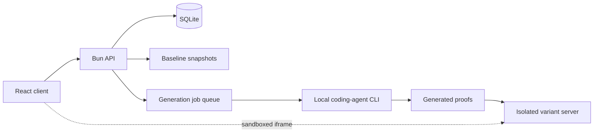

# Design Workbench

A local-first web app for collecting design references, turning them into
design briefs, and comparing AI-generated website directions side by side.

> Portfolio piece. Source shown for review only; not licensed for use. See LICENSE.

## What it does

- **Library:** stores, searches, filters and edits normalized design
  references (URL, screenshots, analysis notes) while keeping each one's
  provenance and evidence limits visible.
- **Briefs:** validates and imports design briefs written in one canonical
  Markdown shape (see `briefs/README.md`), produced by the `design-brief-grill`
  interview skill in `skills/`.
- **Studio:** takes an existing local site as an immutable baseline snapshot,
  holds a grounded conversation with a local coding agent about references and
  the brief, and plans up to five named design directions.
- **Compare:** generates or registers a static proof for each direction from
  two design engines (Impeccable and Taste Skill), shows them in equal isolated
  frames, offers an `ALL 5` contact sheet, branches a chosen direction into
  three refinements, and exposes manifest-declared live tweak controls.

## The problem

Redesigning a site with AI tools produces a lot of options quickly, and the
reasoning behind them gets lost: where a reference came from, what the brief
said, which engine made which page, and why one direction won. Design
Workbench keeps evidence, brief, generated proofs and decisions in one place so
the designer can compare options fairly and keep the trail.

## How it works

A React/Vite client talks to a trusted Bun API backed by SQLite. Uploads are
stored content-addressed; source sites are copied into workbench-owned
snapshots and never modified. Generation jobs run a local coding-agent CLI
(Claude Code by default) with explicit arguments and bounded tools, writing
each proof into its own directory, which is then registered against its
comparison cell. Generated pages are served from a separate, isolated variant
origin: frames use `sandbox="allow-scripts"` without same-origin access, and
the variant server sends a CSP that blocks network connections, forms, top
navigation and embedding. All artifact paths are canonicalized and rejected if
they escape their configured roots.



## Features

- Reference library with provenance, evidence status and editable analysis
- Strict canonical brief parser shared by the API and CLIs
- Baseline snapshots of local source sites, with root allowlisting
- Agent sessions with persisted messages and resume
- Five-direction comparison across two engines, single-direction and `ALL 5`
  views
- Refinement branching from a chosen direction
- Live tweak bar driven by each proof's manifest, with reset and copyable
  decisions
- Operator CLIs: `import:taste-board`, `comparison:new`, `variant:register`
- Three random loopback ports in development (client, API, variants)

## Stack

TypeScript (strict), Bun, React 19, Vite, SQLite (`bun:sqlite`), Zod,
`bun test` with Testing Library and happy-dom.

## Status

Experimental, single-user, run locally. Selected-result handoff and generated
asset rounds are planned, not built. Automated browser capture of external
sites is deferred: references take a URL plus optional screenshots. Some files
in `docs/` describe earlier stages and lag the code (for example
`docs/AGENT-CHAT.md` predates the agent runner).

## Screenshots

None in the repository.

## Running it locally (for reviewers)

```sh
bun install
bun run dev            # prints the three local URLs
bun test
bun run build
```

`bun run import:taste-board` loads the tracked reference seed in
`taste-board/`. Generation expects the Impeccable and Taste Skill agent skills
installed under `.claude/skills/` in the project root; they are third-party
and not included here.

## Author

Rico Rojas, rico@rtech-consulting.com, https://rico-rojas.com
