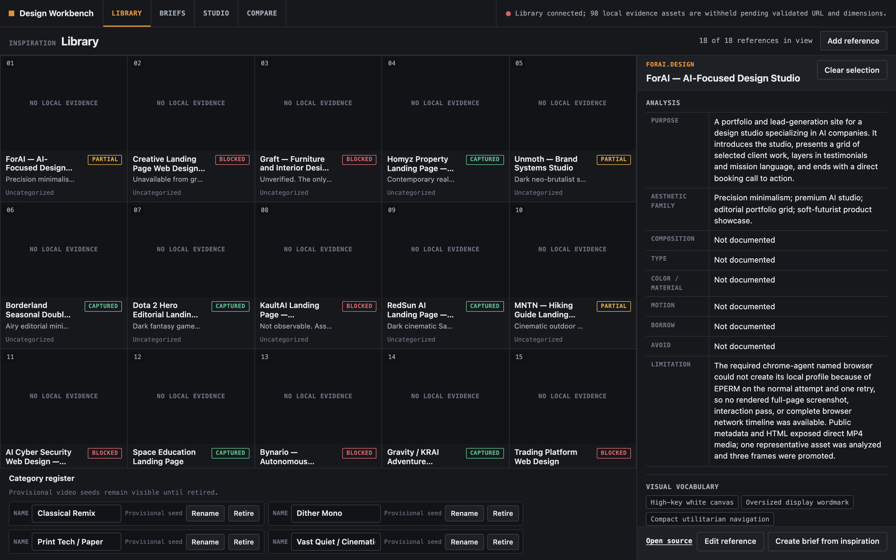
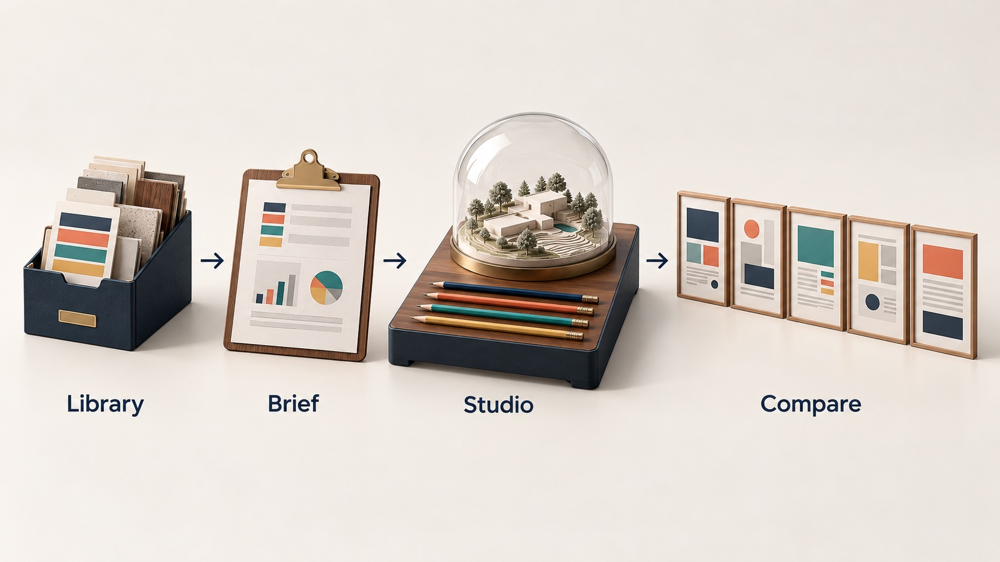
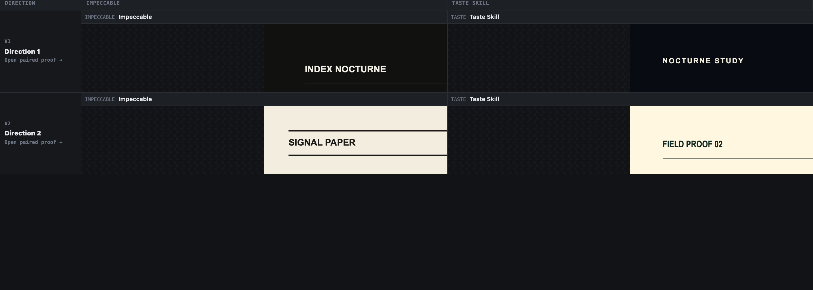

# Design Workbench

A local web app for redesigning a site with AI: collect references, turn
them into a brief, and compare generated design directions side by side
without losing track of where each one came from.


## What it is

Design Workbench is a single-user, local-first tool for a designer or a
small agency working on a site redesign. It has four areas:

- **Library** stores, searches, filters and edits design references (URL,
  screenshots, analysis notes), keeping each one's provenance and evidence
  limits visible.
- **Briefs** validates and imports design briefs written in one canonical
  Markdown shape (see `briefs/README.md`), produced by the
  `design-brief-grill` interview skill in `skills/`.
- **Studio** takes an existing local site as an immutable baseline
  snapshot, holds a grounded conversation with a local coding agent about
  the references and the brief, and plans up to five named design
  directions.
- **Compare** generates or registers a static proof for each direction from
  two design engines, shows them in equal isolated frames, offers an
  `ALL 5` contact sheet, branches a chosen direction into three
  refinements, and exposes live tweak controls declared by each proof.

The two engines are third-party agent skills, not part of this repository:
Impeccable and Taste Skill. The
workbench drives them through a local coding-agent CLI and keeps their
output comparable.

The Library with the tracked reference seed loaded (`bun run
import:taste-board`); real screenshot of the app running locally:



## Why it exists

Redesigning a site with AI tools produces a lot of options quickly, and the
reasoning behind them gets lost: where a reference came from, what the
brief said, which engine made which page, and why one direction won. Design
Workbench keeps evidence, brief, generated proofs and decisions in one
place, so the designer can compare options fairly and keep the trail.

## How it works



A React/Vite client talks to a trusted Bun API backed by SQLite. Uploads
are stored content-addressed; source sites are copied into workbench-owned
snapshots and never modified. Generation runs through a persisted job queue
that calls a local coding-agent CLI (Claude Code by default) with explicit
arguments and bounded tools, writing each proof into its own directory,
which is then registered against its comparison cell. Generated pages are
served from a separate, isolated variant origin: frames use
`sandbox="allow-scripts"` without same-origin access, and the variant
server sends a CSP that blocks network connections, forms, top navigation
and embedding. All artifact paths are canonicalized and rejected if they
escape their configured roots.

Compare, showing a two-direction comparison filled with the test fixture
proofs from `tests/fixtures/variants` (real screenshot; the fixture pages
are deliberately minimal):



## Features

- Reference library with provenance, evidence status and editable analysis
- Strict canonical brief parser shared by the API and the CLIs
- Baseline snapshots of local source sites, with root allowlisting
- Agent sessions with persisted messages and resume
- Persisted generation job queue with cancel, retry and recovery of jobs
  orphaned by a restart
- Five-direction comparison across two engines, single-direction and
  `ALL 5` views, at desktop, tablet and mobile viewports
- Refinement branching from a chosen direction, in three deliberate lenses
  (restraint, emphasis, texture)
- Live tweak bar driven by each proof's manifest; tweak decisions can be
  saved, restored and applied as a new immutable revision
- Read-only handoff packet (JSON or Markdown) recording the source and
  baseline hash behind every decision
- Operator CLIs: `import:taste-board`, `comparison:new`, `variant:register`
- Three random loopback ports in development (client, API, variants)

## Stack

TypeScript (strict), Bun, React 19, Vite, SQLite (`bun:sqlite`) with
numbered migrations, Zod, `bun test` with Testing Library and happy-dom.

## Run it locally (for review)

```sh
bun install
bun run dev            # prints the three local URLs
bun test
bun run build
```

`bun run import:taste-board` loads the tracked reference seed in
`taste-board/`. Generation expects the Impeccable and Taste Skill agent
skills installed under `.claude/skills/` in the project root; they are
third-party and not included here, so the 8 generation and refinement tests
that copy them fail without them (230 of 239 tests pass on a clean
checkout, 1 is marked todo).

Free for personal and non-commercial use with credit; commercial use needs
a licence. See [LICENSE](LICENSE) (PolyForm Noncommercial 1.0.0).

## Project status

Experimental, single-user, run locally. Writing a chosen result back into
the source site is deliberately not built: the handoff packet records the
decision and applies nothing. Automated browser capture of external sites
is deferred; references take a URL plus optional screenshots. Some files in
`docs/` describe earlier stages and lag the code (for example
`docs/AGENT-CHAT.md` predates the agent runner).

## How it was built

Built with Claude as the coding agent, in small commits that each name the
defect or gap they close and the test that caught it. The recorded history
starts on 2026-07-24 with a run of ten commits that turned a blocking
generate-all loop into a job queue, made refinements real, and hardened the
contract between AI-generated pages and the app. The full story is in
[docs/BUILD-STORY.md](docs/BUILD-STORY.md).

## Credits

- Impeccable and Taste Skill, the
  design engines Compare runs.
- [Claude Code](https://claude.com/claude-code), the default local agent
  CLI for generation.

## Author

Rico Rojas, https://rico-rojas.com
